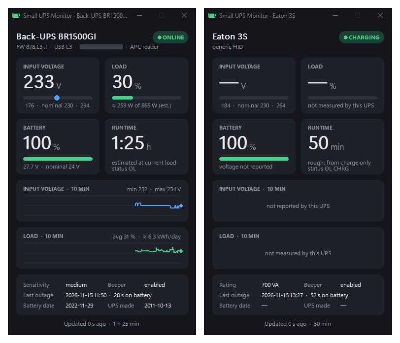
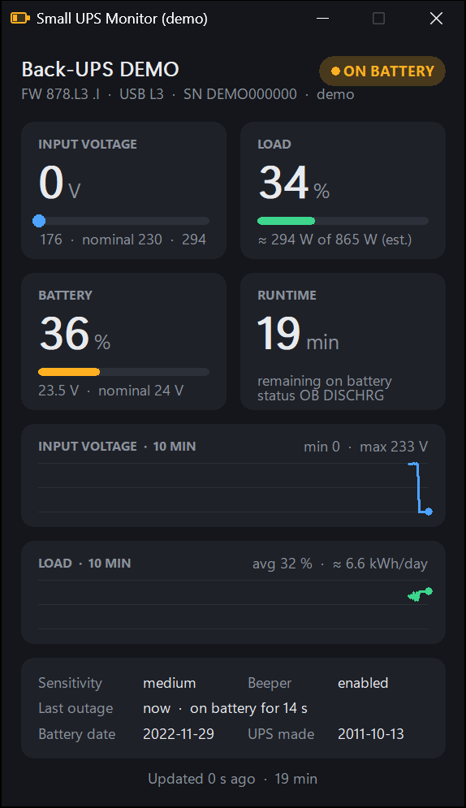

# Small UPS Monitor

A small, fast Windows monitor for USB UPSes. One ~0.5 MB exe, no installer, no service, no driver, no runtime. It reads the UPS directly through Windows' built-in HID support and shows its state in a compact window and a tray icon.

It was written as a lightweight replacement for the APC PowerChute Personal Edition status window, and it also works with other brands' HID UPSes.

<p>
  
  
</p>

*Left: an APC Back-UPS (APC reader) and an Eaton 3S (generic HID reader), each with its own window. Right: `--demo` during a simulated power failure.*

- **Tiny:** a single exe of about 0.5 MB that uses only system DLLs. It needs about 3 MB of RAM and close to zero CPU.
- **Read-only:** it never changes UPS settings and can run next to PowerChute or the vendor's own software.
- **One window and tray icon per UPS:** several UPSes can be monitored at once.
  - Unplugging a UPS's USB shows it as OFFLINE; after 10 s its window and tray icon close.
  - Plugging a UPS in pops its window up.
  - With no UPS connected, a small window just says "Please connect UPS".
- **Shows:** status, input voltage against the transfer range, load with estimated watts (or VA), charge, runtime, battery voltage, 10-minute charts, energy rate (≈ kWh/day), last outage with its duration, and settings. Anything a UPS doesn't report is marked as not reported.
- **Tray icon:** a battery in the status colour, filled to the charge level.
- **Notifications** for power failure, power restored, low battery, UPS shutting down, battery needing replacement, and disconnects.
- **Event log** in CSV.

## Supported UPSes

| Reader | Used for | Tested on |
|---|---|---|
| **APC reader** | APC units (USB vendor ID `051D`) | APC Back-UPS BR1500GI. It also reads APC-specific data: sensitivity, status flag and battery dates. |
| **Generic HID reader** | any other UPS that follows the USB HID Power Device standard | Eaton 3S 700 |

The generic reader finds fields by their standard names in the device's own descriptor, so report numbers don't matter. Other HID UPSes (CyberPower, other Eaton/MGE models, etc.) should work, but haven't been tested. Some models leave fields out or report them oddly; see [Known limits](#known-limits).

**Have a different UPS?** Please help add it: right-click a tray icon → **Create UPS report…**, then **Report a UPS on GitHub…**. It takes about two minutes and your serial number is hidden. See [Adding your UPS](docs/ADDING-A-UPS.md).

## Install

1. Download `small-ups-monitor.exe` from [Releases](../../releases).
2. Put it anywhere, for example `%LOCALAPPDATA%\Programs\Small UPS Monitor\`, and run it.
3. Optionally, right-click the tray icon → **Start with Windows**.

Windows 10 or 11 (x64). No administrator rights needed.

**Windows 7 / Server 2008 R2?** Download `small-ups-monitor-win7.exe` instead — the same app, built for NT 6.1.

## Use

| Action | How |
|---|---|
| Show / hide a UPS window | Left-click that UPS's tray icon |
| Menu | Right-click a tray icon: version (opens Releases), Show / hide, Always on top, Notifications, Start with Windows, Open event log, Create UPS report…, Report a UPS on GitHub…, Exit |
| Close button | Hides that window to the tray (the app keeps running) |
| Quit | Tray menu → Exit |
| Check your version | The top line of the tray menu (click it to open Releases), or the window's title-bar menu → **About Small UPS Monitor…** |

Command line:

```
small-ups-monitor.exe            normal start
small-ups-monitor.exe --tray     start hidden in the tray (used by "Start with Windows")
small-ups-monitor.exe --demo     simulated UPS: online → on battery → low → unplugged → charging (70 s cycle)
small-ups-monitor.exe --report   write a UPS report, open it in Notepad, and exit
```

Only one instance runs at a time; starting it again brings a window forward. Demo mode runs as a separate instance with its own log.

**Files:** everything lives in `%APPDATA%\Small UPS Monitor\`.
- `settings.ini` holds window positions per UPS, plus Always on top and Notifications.
- `events.csv` is the event log, with columns `time,event,detail,ups`.

**Start with Windows** adds the value `Small UPS Monitor` under `HKCU\Software\Microsoft\Windows\CurrentVersion\Run`. If the exe moves, the path is updated the next time it starts.

**Notifications** use the standard Windows notification area, so Windows notifications must be turned on.

## Known limits

- **Watts are estimated** as rated W × load %. Small UPSes don't measure real power; PowerChute uses the same estimate.
- **APC Back-UPS BR1500GI:** it doesn't report output voltage, frequency or temperature. Its "last transfer cause" isn't updated live, so the app shows its own record of the last outage instead.
- **Eaton 3S 700:**
  - It doesn't report input or battery voltage.
  - It reports load as 0 % whatever is connected, so the app shows "not measured by this UPS".
  - Its runtime is just charge × 50 min, so it's marked as rough. NUT users see the same behaviour.
- **Shutdown:** the app doesn't shut down the PC. Keep PowerChute, NUT or Windows' own power settings for that.
- **Identical UPSes:** two UPSes with identical vendor, product and serial number (some report all zeros) can't be told apart.

Tested on Windows 11 with real mains outages and USB unplug and replug on both test UPSes.

## Build

Requires Rust (MSVC toolchain) and the Visual Studio Build Tools with the C++ workload.

```
cargo build --release
cargo test --all-features
```

The exe is `target\release\small-ups-monitor.exe`. The C runtime is linked statically, so no Visual C++ Redistributable is needed.

### Build for Windows 7 / Server 2008 R2

The normal build targets Windows 10+. To build an exe that runs on Windows 7 or
Windows Server 2008 R2, use the Win7 target (see
[docs/BUILDING-WINDOWS-7.md](docs/BUILDING-WINDOWS-7.md)):

```
rustup toolchain install nightly
rustup component add rust-src --toolchain nightly
cargo +nightly build -Z build-std --target x86_64-win7-windows-msvc --release
```

### Diagnostics

```
cargo run --release -p ups-core --features win32 --example hiddump
cargo run --release -p ups-core --features win32 --example watch -- 300
cargo run --release -p ups-core --features win32 --example rawlog -- 300
```

- **`hiddump`** prints the UPS report, the same one as **Create UPS report…** (see [Adding your UPS](docs/ADDING-A-UPS.md#for-developers)).
- **`watch`** prints a UPS's decoded values whenever they change, and survives unplug and replug.
- **`rawlog`** logs an APC unit's raw reports once per second.

## Layout

```
core/            UI-independent logic (crate ups-core)
  decode.rs      Snapshot model; APC report bytes -> Snapshot
  hid_win32.rs   SetupAPI enumeration of HID UPS collections; APC reader; reader choice per device
  hidmap.rs      device layout from Windows preparsed data (usage paths, report IDs, unit scaling)
  generic.rs     generic reader (standard usage paths -> Snapshot) and per-model quirks
  poller.rs      one background thread per UPS; reconnects
  report.rs      the UPS report (Create UPS report…, --report, hiddump)
  demo.rs        simulated UPS for --demo
  icon.rs        battery icon (signed-distance-field drawing, pixel-snapped)
  history.rs     ring buffer for the charts, with gaps for missing data
app/             the Windows app (crate small-ups-monitor)
  main.rs        windows per UPS, device watcher, tray commands, notifications
  ui.rs, gfx.rs  layout and double-buffered GDI drawing
  tray.rs        Shell_NotifyIcon with runtime-drawn icons
  settings.rs, autostart.rs, eventlog.rs
  build.rs       embeds the icon and version info
docs/            adding a UPS, APC BR1500GI HID protocol notes, raw layouts of the tested UPSes
tools/           the original PowerShell probes (APC only)
```

## Trademarks

APC, Back-UPS and PowerChute are trademarks of Schneider Electric. Eaton is a trademark of Eaton Corporation. They are mentioned only to describe compatibility; this project is not affiliated with or endorsed by either company.

## License

[MIT](LICENSE)
